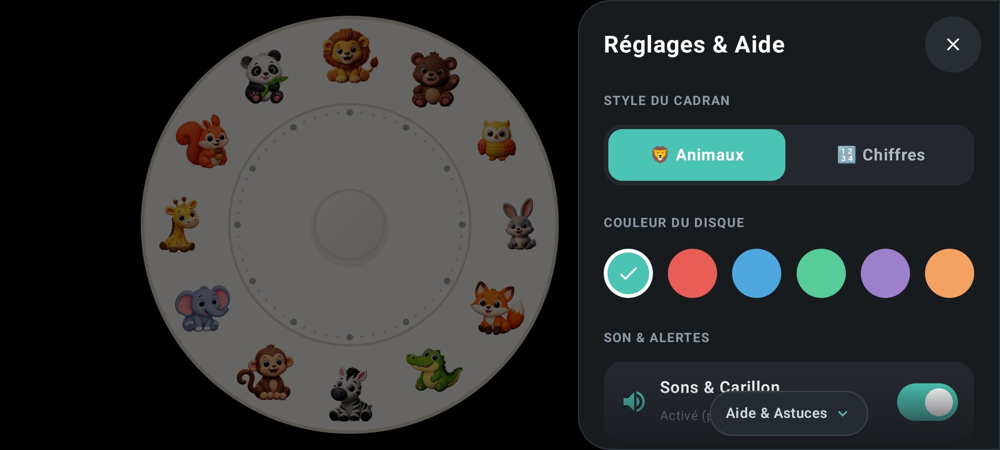

<div align="center">
  <h1> Child Timer</h1>
  <p><strong>Le temps devient visible, simplement.</strong></p>
  <p>Un minuteur visuel Android doux, ludique et épuré, conçu pour aider les enfants à appréhender le temps qui passe grâce à un disque coloré, des animaux attachants ou des chiffres clairs.</p>
  <p>
    
    
    
    
  </p>
</div>

<p align="center">
  
  
</p>

<p align="center">
  <a href="https://github.com/aciderix/Child-timer/raw/refs/heads/main/ChildTimer.apk"><strong>⬇️ Télécharger l’APK Android</strong></a>
</p>

## 🧸 À propos

**Child Timer** est une application Android minimaliste inspirée des minuteurs visuels mécaniques analogiques pour enfants. Elle matérialise une durée sous la forme d'un secteur circulaire coloré qui diminue progressivement dans le sens inverse des aiguilles d'une montre jusqu'à disparaître.

L'interface est pensée pour les tout-petits et les familles :
- **Immersion totale en paysage** : les barres système Android sont masquées et l'écran reste allumé pendant toute la durée du décompte.
- **Zéro distraction pendant le timer** : aucun bouton, chiffre numérique ni menu n'est affiché pendant le décompte pour favoriser le calme et la concentration.
- **Accès parent discret** : un volet latéral coulissant permet d'ajuster les préférences à l'arrêt, et se verrouille automatiquement dès que le timer démarre.

---

## ✨ Fonctionnalités

- **2 styles de cadran au choix :**
  - 🦁 **Mode Animaux** : 12 animaux illustrés chaleureux pour guider les plus jeunes sans notion de lecture de chiffres.
  - 🔢 **Mode Chiffres** : repères des minutes de 5 en 5 (**5, 10, 15... 60**) dans de douces pastilles rondes adaptées aux enfants qui apprennent à lire l'heure.
- **Durées de 5 à 60 minutes**, par pas de 5 minutes (chaque position correspond à un animal ou un multiple de 5 minutes).
- **Palette de 6 teintes pastel douces :**
  - 🌊 *Turquoise doux* (frais et apaisant)
  - 🍎 *Corail Time Timer* (la couleur classique et iconique des minuteurs mécaniques)
  - ☁️ *Bleu Ciel* (calme et reposant)
  - 🍃 *Vert Menthe* (tendre et naturel)
  - 🪻 *Lavande / Lilas* (doux et poétique)
  - 🍑 *Pêche Dorée* (chaleureux et joyeux)
- **Volet latéral « Réglages & Aide » :** accessible à l'arrêt via une discrète poignée en demi-cercle sur le bord droit, avec indicateur de défilement pour consulter les astuces d'utilisation.
- **Disque visuel animé :** se remplit immédiatement dans le sens horaire au toucher d'une durée, puis se rétracte doucement en temps réel (basé sur l'horloge système `System.currentTimeMillis()`).
- **Bouton Lecture ludique :** apparaît à droite dès qu'une durée est choisie, avec pulsation invitant au toucher. Au lancement, le cadran glisse doucement pour venir se centrer sur l'écran.
- **Sons doux et chaleureux :** clics marimba graves lors du toucher, carillon d'alarme à la fin du timer, audibles même si le téléphone est en mode *Ne pas déranger* (DND).
- **Mode silencieux :** désactivation complète des sons en un clic depuis le volet parent.
- **Vibrations haptiques :** légères vibrations pour confirmer le toucher et la fin du temps.
- **Célébration positive :** pluie d'étoiles scintillantes et mascotte du renard au centre du cadran lorsque le temps est écoulé.

---

### 🦁 Les 12 animaux et leurs durées

| Position | Animal | Repère chiffré | Durée |
|---|---|:---:|---:|
| 1 h |  Ours | **5** | 5 min |
| 2 h |  Hibou | **10** | 10 min |
| 3 h |  Lapin | **15** | 15 min (un quart) |
| 4 h |  Renard | **20** | 20 min |
| 5 h |  Croco | **25** | 25 min |
| 6 h |  Zèbre | **30** | 30 min (la moitié) |
| 7 h |  Singe | **35** | 35 min |
| 8 h |  Éléphant | **40** | 40 min |
| 9 h |  Girafe | **45** | 45 min (trois quarts) |
| 10 h |  Écureuil | **50** | 50 min |
| 11 h |  Panda | **55** | 55 min |
| 12 h |  Lion | **60** | 60 min (tour complet) |

---

## ▶️ Utilisation

1. **Choisir la durée** : Touche l'animal (ou le chiffre) souhaité. Le disque se colore instantanément jusqu'à cette position.
2. **Lancer le minuteur** : Appuie sur le gros bouton **Lecture** qui apparaît à droite.
3. **Pendant le décompte** : Le cadran se centre. Le disque se rétracte progressivement vers le haut (midi). Les interactions tactiles sur le cadran sont verrouillées pour éviter les fausses manipulations.
4. **Fin du timer** : Lorsque le disque disparaît, une douce mélodie retentit avec des étoiles scintillantes.

### 🕹️ Commandes et gestes pour les parents

- **Ouvrir les réglages :** Touche la petite poignée en demi-cercle sur le bord droit de l'écran (uniquement disponible à l'arrêt).
- **Réinitialiser pendant le décompte :** Maintiens appuyé le bouton au centre du cadran pendant **3 secondes**. Un anneau de progression circulaire visible accompagne le maintien, puis réinitialise le timer avec une vibration de confirmation.
- **Relancer après la fin du timer :** Touche simplement le renard au centre du cadran pour revenir à l'écran initial.
- **Couper ou activer le son :** Utilise l'interrupteur dédié dans le volet Réglages.

> 🔒 **Sécurité enfant :** Le volet latéral et sa poignée sont automatiquement désactivés et invisibles pendant toute la durée du compte à rebours.

---

## 📱 Compatibilité

- Android **7.0 (API 24) ou supérieur**.
- Interface conçue exclusivement pour l'orientation **paysage**.
- SDK Android ciblé : **36** (Android 16).

---

## 🛠️ Technologies

- **Kotlin**
- **Jetpack Compose** & Material Design 3
- **Android Gradle Plugin 9.0.1** & **Gradle 9.1.0**
- **JDK 17**
- Synthèse sonore acoustique via `AudioTrack` (`AudioAttributes.USAGE_ALARM` pour traverser le mode silencieux/DND) et retour haptique Android.

---

## 🔧 Construire l'application

### Prérequis
Installe un JDK 17 et le SDK Android avec la plateforme Android API 36.

### Compiler et tester
Sur Linux ou macOS :
```bash
./gradlew testDebugUnitTest assembleDebug
```
Sur Windows :
```bat
gradlew.bat testDebugUnitTest assembleDebug
```

L'APK de débogage est produit dans :
```text
app/build/outputs/apk/debug/app-debug.apk
```
*(Une copie prête à l'emploi est également placée directement à la racine du dépôt : `ChildTimer.apk`)*.

---

## 📦 Publier une release APK

Le workflow GitHub Actions `.github/workflows/release-apk.yml` est conçu pour construire, signer et joindre automatiquement l'APK à une **GitHub Release** lorsqu'un tag `v*` est poussé.

### 1. Créer une clé de signature
Sur ta machine :
```bash
keytool -genkeypair -v -keystore child-timer-release.jks -alias child-timer -keyalg RSA -keysize 2048 -validity 10000
```
*Conserve précieusement ce fichier et ses mots de passe hors du dépôt Git.*

### 2. Ajouter les secrets GitHub
Dans **Settings → Secrets and variables → Actions**, crée les 4 secrets suivants :
- `ANDROID_KEYSTORE_BASE64` : contenu Base64 du fichier `.jks`.
- `ANDROID_KEY_ALIAS` : alias de la clé (`child-timer`).
- `ANDROID_KEYSTORE_PASSWORD` : mot de passe du keystore.
- `ANDROID_KEY_PASSWORD` : mot de passe de la clé.

### 3. Déclencher la publication
```bash
git tag v1.0
git push origin v1.0
```
Le workflow compile l'APK release, le signe, vérifie sa signature et crée la release GitHub avec l'APK joint.

---

## 🔒 Confidentialité

L'application ne collecte aucune donnée, ne requiert aucun compte, ne contient aucune publicité et ne demande aucune permission superflue (aucune permission Internet). Tous les sons sont synthétisés localement sur l'appareil.

---

## 📄 Licence

Projet personnel open-source — conditions de réutilisation et de redistribution à définir par l'auteur.
