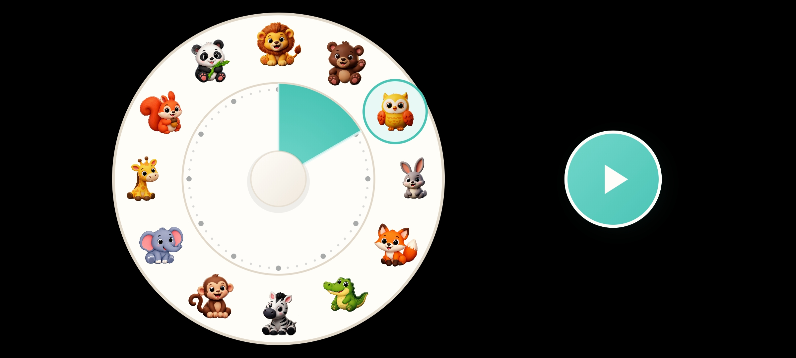

  <h1> Child Timer</h1>
  
<strong>Le temps devient visible, simplement.</strong>

  
Un minuteur visuel Android conçu pour aider les enfants à comprendre le temps qui passe, sans chiffres au cadran ni compte à rebours numérique.

  

    
    
    
    
  

  

  <a href="ChildTimer.apk?raw=1"><strong>⬇️ Télécharger l’APK Android (build de test)</strong></a> 
  Le fichier actuel est identique à <code>app-debug.apk</code>. Pour une version de production signée, consulte les GitHub Releases.

## 🧸 À propos

**Child Timer** est une application Android minimaliste qui représente une durée sous la forme d'un secteur coloré sur un cadran. L'enfant choisit l'un des animaux placés autour du cadran, puis lance le timer. Le secteur turquoise se réduit progressivement jusqu'à la fin du temps choisi.

L'interface est volontairement immersive : elle fonctionne en **paysage**, masque les barres système Android et maintient l'écran éveillé pendant l'utilisation.

## ✨ Fonctionnalités

- **12 animaux illustrés** disposés autour du cadran.
- **Durées de 5 à 60 minutes**, par pas de 5 minutes : un animal correspond à une durée.
- **Cadran sans chiffres** et sans affichage numérique du temps restant.
- **Secteur turquoise animé** qui matérialise le temps disponible puis diminue pendant le décompte.
- **Bouton Lecture** qui apparaît après le choix d'un animal.
- **Retour sonore doux** lors de la sélection et du démarrage, puis une mélodie à la fin.
- **Vibrations discrètes** pour accompagner certaines interactions.
- **Petite célébration visuelle** à la fin du timer, avec des étoiles et un renard au centre.
- **Plein écran paysage** pour que le cadran reste au centre de l'expérience.

### Les animaux et leurs durées

| Position du cadran | Animal | Durée |
|---|---|---:|
| 1 h |  Ours | 5 min |
| 2 h |  Hibou | 10 min |
| 3 h |  Lapin | 15 min |
| 4 h |  Renard | 20 min |
| 5 h |  Croco | 25 min |
| 6 h |  Zèbre | 30 min |
| 7 h |  Singe | 35 min |
| 8 h |  Éléphant | 40 min |
| 9 h |  Girafe | 45 min |
| 10 h |  Écureuil | 50 min |
| 11 h |  Panda | 55 min |
| 12 h |  Lion | 60 min |

## ▶️ Utilisation

1. Ouvre l'application en mode paysage.
2. Touche l'animal correspondant à la durée souhaitée. Le secteur turquoise montre la durée sélectionnée.
3. Appuie sur le gros bouton **Lecture** qui apparaît à droite.
4. Laisse l'enfant observer le secteur diminuer. À la fin, une animation, un son et une vibration signalent que le temps est écoulé.

### Commandes disponibles

- **Activer ou couper le son :** maintenir le petit moyeu au centre du cadran pendant environ 3 secondes.
- **Réinitialiser avant la fin :** toucher rapidement le moyeu central 10 fois.
- **Revenir au choix de durée après la fin :** toucher le renard au centre.

> Le contrôle du son et la réinitialisation reposent actuellement sur des gestes cachés, plutôt que sur des boutons visibles.

## 📱 Compatibilité

- Android **7.0 (API 24) ou supérieur**.
- Interface prévue pour le **paysage**.
- SDK Android ciblé : **36**.

## 🛠️ Technologies

- **Kotlin**
- **Jetpack Compose** et Material 3
- **Android Gradle Plugin 9.0.1**
- **Gradle 9.1.0**
- **JDK 17**
- Sons synthétisés localement via <code>AudioTrack</code> et retour haptique via les API Android.

## 🔧 Construire l'application

### Prérequis

Installe un JDK 17 et le SDK Android avec la plateforme Android API 36.

### Compiler et tester

Sur Linux ou macOS :

~~~bash
./gradlew testDebugUnitTest assembleDebug
~~~

Sur Windows :

~~~bat
gradlew.bat testDebugUnitTest assembleDebug
~~~

L'APK de débogage est généré dans :

~~~text
app/build/outputs/apk/debug/app-debug.apk
~~~

Pour produire la variante release non signée localement :

~~~bash
./gradlew assembleRelease
~~~

La variante release n'est pas installable tant qu'elle n'a pas été signée. La procédure de publication automatique est décrite ci-dessous.

## 📦 Publier une release APK

Le workflow GitHub Actions <code>.github/workflows/release-apk.yml</code> est conçu pour construire, signer et joindre l'APK à une **GitHub Release** lorsqu'un tag <code>v*</code> est poussé. Il nécessite une clé de signature privée, à conserver hors du dépôt.

### 1. Créer une clé de signature

Sur ta machine, exécute :

~~~bash
keytool -genkeypair -v -keystore child-timer-release.jks -alias child-timer -keyalg RSA -keysize 2048 -validity 10000
~~~

**Conserve précieusement ce fichier et ses mots de passe. Ne commite jamais la clé dans Git.** La même clé doit être réutilisée pour les prochaines versions afin de permettre les mises à jour de l'application.

### 2. Ajouter les secrets GitHub

Dans **Settings → Secrets and variables → Actions**, crée les secrets suivants :

- <code>ANDROID_KEYSTORE_BASE64</code> : contenu Base64 du fichier <code>.jks</code>.
- <code>ANDROID_KEY_ALIAS</code> : alias utilisé à la création de la clé (ici <code>child-timer</code>).
- <code>ANDROID_KEYSTORE_PASSWORD</code> : mot de passe du keystore.
- <code>ANDROID_KEY_PASSWORD</code> : mot de passe de la clé.

Sous Windows PowerShell, cette commande copie le contenu Base64 du keystore dans le presse-papiers :

~~~powershell
[Convert]::ToBase64String([IO.File]::ReadAllBytes(".\child-timer-release.jks")) | Set-Clipboard
~~~

Colle cette valeur uniquement dans le secret GitHub correspondant, jamais dans un fichier du dépôt.

### 3. Déclencher la publication

La version actuelle du projet indique <code>versionName = "1.0"</code>. Après avoir vérifié la version et la configuration, crée puis pousse le tag correspondant :

~~~bash
git tag v1.0
git push origin v1.0
~~~

Le workflow construit un APK release, le signe, vérifie sa signature puis crée une release avec l'APK en pièce jointe. Les prochaines versions devront augmenter <code>versionCode</code> et mettre à jour <code>versionName</code> dans <code>app/build.gradle.kts</code> avant de pousser leur tag.

**Avant la toute première release publique**, vérifie également que l'identifiant Android <code>applicationId = "com.aistudio.childtimer.kxrqzp"</code> est bien celui que tu souhaites conserver. Le changer après la publication empêcherait l'APK suivant d'être reconnu comme une mise à jour de cette application.

Pour installer rapidement la build de test, utilise le lien de téléchargement en haut du README. Les versions de production signées seront disponibles dans les [GitHub Releases](https://github.com/aciderix/Child-timer/releases) une fois la clé de signature configurée.

## 🔒 Confidentialité

Le manifeste Android ne déclare pas de permission réseau ; il déclare uniquement la permission de vibration. Les sons du timer sont synthétisés localement. L'application n'a pas besoin de compte utilisateur pour son fonctionnement actuel.

## 🧭 Périmètre actuel

Cette version est centrée sur le cadran animalier. Elle ne propose pas encore de compte à rebours chiffré, de pause/reprise, de préréglages de routines, de durée personnalisée ou d'historique. Le README décrit volontairement le fonctionnement de l'écran réellement lancé par l'application, et non les anciennes interfaces présentes dans le code source.

## 📄 Licence

Aucun fichier de licence n'est actuellement fourni dans le dépôt. Les conditions de réutilisation et de redistribution restent donc à définir.
